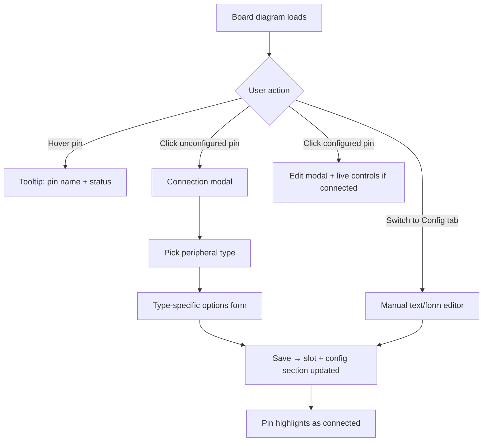

# Visual Board UI Spec

**Primary interaction model** for goklippy — configure hardware by pointing at the board, not by hunting through config sections.

Applies first to **RAMPS 1.4**; future boards ship their own diagram + hotspot map.

---

## Design Principles

1. **Visual first** — the board diagram is the default setup and dashboard entry point.
2. **Progressive disclosure** — hover for identity, click for configuration, advanced users open manual config.
3. **Bi-directional sync** — visual edits update Klipper config; manual config edits update pin highlights on the diagram.
4. **Honest affordances** — pins show connected / unconfigured / live-active / error states with distinct styling.

---

## Primary Views

### 1. Board Setup (visual)

```
┌─────────────────────────────────────────────────────────────┐
│  RAMPS 1.4          [ Visual ● ] [ Config file ]            │
├──────────────────────────────┬──────────────────────────────┤
│                              │  Connection panel            │
│   ┌─────────────────────┐    │  (opens on pin click)        │
│   │  Board SVG/image    │    │                              │
│   │  · hover → tooltip  │    │  Pin: T0 (Hotend)            │
│   │  · click → panel →  │    │  Type: [ Thermistor ▼ ]      │
│   │                      │    │  Sensor: NTC 100K β3950      │
│   │  [X][Y][Z][E0]...   │    │  Label: Hotend               │
│   └─────────────────────┘    │  [ Connect ] [ Clear ]       │
│                              │                              │
│  Legend: ● connected ○ empty │                              │
└──────────────────────────────┴──────────────────────────────┘
```

### 2. Config file (manual)

Tab or split toggle — full Klipper config editing:

- **Section list** sidebar (grouped)
- **Structured form** for selected section
- **Raw text editor** (monaco/codemirror-style) for full file or single section
- Changes reflect back on the board diagram when saved or on blur (debounced sync)

### 3. Live dashboard (visual + controls)

Same board diagram with **live overlays**:

- Connected pins pulse or show live values (temp on T0, endstop triggered, fan on)
- Click a connected pin → inline control (jog, toggle, slider) without leaving the board view
- Optional collapsible **control deck** below for detailed parameters

---

## Interaction Flow



---

## Connection Modal — Peripheral Types

When user clicks a hotspot, they choose **what is wired here** (options filtered by what the pin supports):

| Pin / header type | User picks | Options shown |
|-------------------|------------|---------------|
| Stepper driver socket | Stepper axis | Axis name, invert dir, microsteps note, enable behavior |
| TEMP header | Thermistor | Sensor type, pullup, label |
| MOSFET output | Heater / Fan / Relay | Max PWM, shutdown value, label |
| Endstop header | Endstop | Invert, NC/NO, axis association |
| SERVO header | Servo | Min/max angle, initial position |
| Aux digital | Relay / GPIO out | Invert, default value |

**Clear / Disconnect** removes the slot assignment and greys out the pin.

---

## Visual States

| State | Appearance |
|-------|------------|
| Unconfigured | Neutral grey hotspot, dotted outline on hover |
| Configured (idle) | Solid color by type (stepper=blue, temp=orange, fan=cyan, etc.) |
| Live connected | Ring/glow + live readout badge |
| Error / shutdown | Red border + tooltip with MCU error |
| Selected | Strong outline, connection panel open |

---

## Board Diagram Asset Format

Stored per profile in `backend/profiles/`:

```
ramps14.yaml          # slot definitions + metadata
ramps14-diagram.svg   # board illustration
ramps14-hotspots.json # clickable regions (or embedded in YAML)
```

**Hotspot entry (example):**

```yaml
diagram:
  image: ramps14-diagram.svg
  viewBox: "0 0 800 600"
  hotspots:
    - id: temp_t0
      slot_ids: [thermistor_t0]
      label: T0 — Hotend
      shape: circle
      cx: 412
      cy: 288
      r: 14
      accepts: [thermistor]
    - id: driver_x
      slot_ids: [stepper_x]
      label: X Stepper
      shape: rect
      x: 120
      y: 80
      width: 56
      height: 48
      accepts: [stepper]
    - id: mosfet_d10
      slot_ids: [heater_hotend]
      label: D10 — Hotend heater
      shape: rect
      x: 340
      y: 120
      width: 36
      height: 24
      accepts: [heater, fan, relay]
```

Frontend renders SVG as background; hotspots are transparent HTML/SVG overlay elements with `pointer-events`.

**v1 asset approach:** Start with a clean **SVG diagram** (top-down RAMPS + Mega outline with labeled headers). Photo-real image optional in v2 if hotspots are accurate enough.

---

## API Support

```
GET /api/board-profiles/:id/diagram
  → { image_url, viewBox, hotspots[], slots[] }

GET /api/board-setups/:id/visual-state
  → hotspots with connected: bool, label, live values if session active

PUT /api/board-setups/:id/slots/:slotId
  → update from visual modal; triggers config sync
```

---

## Manual Config Access

Always available via:

- **Tab bar:** `Visual` | `Config file` on setup/editor pages
- **Keyboard shortcut:** `Ctrl+Shift+C` toggles raw editor (optional)
- **Per-section "View in config"** link on connection modal → jumps to raw section in editor

Manual edits parse back to visual state on save/reload.

---

## RAMPS 1.4 Diagram Coverage (v1)

Minimum hotspots for MVP:

- 5 stepper driver sockets (X, Y, Z, E0, E1)
- 4 thermistor headers (T0–T3)
- 3 MOSFET outputs (D8, D9, D10)
- 6 endstop headers
- 1–2 servo headers
- Power / USB labels (informational, not clickable)

---

## Frontend Components

```
BoardDiagram/
  BoardDiagram.js           # SVG + hotspot layer
  BoardDiagram.logic.js     # hover, click, state mapping
  BoardDiagram.module.css
  HotspotOverlay.js
  ConnectionModal.js        # type picker + options form
  PinStateLegend.js

ConfigEditor/
  ConfigEditor.js           # tab container: Visual | Config
  ConfigSectionList.js
  ConfigRawEditor.js        # manual text
  ConfigFormEditor.js       # structured keys
```

---

## Success Criteria

- User can configure a minimal bench rig (X stepper + T0 + D9 fan) without opening raw config
- Clicking T0 after load from `printer.cfg` shows existing thermistor settings
- Raw config edit of `sensor_pin` updates T0 hotspot on diagram after save
- Live temp appears on T0 hotspot when dashboard session is active
